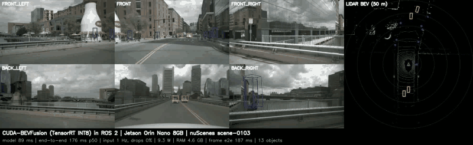

# ROS2 BEV-Fusion

ROS2 nodes for running BEV-Fusion 3D object detection with CUDA acceleration.



*INT8 TensorRT BEVFusion in ROS 2 on a Jetson Orin Nano 8 GB, nuScenes scene-0103 ([full-res mp4](docs/demo.mp4)).*

## Project Description

This project provides a ROS2 implementation of **BEV-Fusion**, a state-of-the-art 3D object detection system that fuses camera and LiDAR sensor data. BEV-Fusion performs bird's-eye-view (BEV) feature extraction from multi-camera images and LiDAR point clouds, then combines these features to detect and localize objects in 3D space.

The ROS2 package is platform-agnostic and can run on systems with CUDA support. It requires meeting the [CUDA-BEVFusion requirements](https://github.com/NVIDIA-AI-IOT/Lidar_AI_Solution/tree/master/CUDA-BEVFusion) (CUDA toolkit, TensorRT, etc.). The setup instructions provided are optimized for NVIDIA Jetson devices, but can be adapted for other CUDA-capable systems.

**Tested Platforms:**
- Jetson Orin Nano Super 8 GB (ARM64, JetPack 5 / L4T R35)
- NVIDIA Tesla P100 (x86_64, CUDA)

### What It Achieves

- **3D Object Detection**: Detects 10 object classes (cars, trucks, buses, pedestrians, motorcycles, bicycles, etc.) with TensorRT FP16 or INT8 engines
- **Multi-Sensor Fusion**: Fuses data from 6 cameras and 1 LiDAR sensor for robust perception
- **Bird's-Eye-View Processing**: Converts camera images to BEV representation for unified feature space with LiDAR
- **ROS2 Integration**: Publishes detections as standard ROS2 messages (`vision_msgs/Detection3DArray`) for integration with other ROS2 systems
- **Performance Metrics**: Publishes inference timing and FPS metrics for performance monitoring
- **NuScenes Dataset Support**: Replays NuScenes dataset for testing and evaluation

The system processes synchronized camera images and LiDAR point clouds, runs inference using TensorRT-optimized models, and publishes 3D bounding boxes with class labels and confidence scores.

## Benchmark (Jetson Orin Nano 8 GB, nuScenes mini)

FP16 TensorRT baseline vs. INT8 PTQ, ResNet50 camera + LiDAR. Full details and methodology in [bench/RESULTS.md](bench/RESULTS.md).

| | FP16 | INT8 | Δ |
|---|---|---|---|
| Model latency p50 (offline) | 150.6 ms | 115.7 ms | −23% |
| ROS 2 end-to-end latency p50 | 210 ms | 176 ms | −16% |
| mAP / NDS (mini_val) | 0.577 / 0.582 | 0.574 / 0.581 | −0.3 / −0.1 pt |
| Energy per frame | 3.11 J | 2.22 J | −29% |
| Frames dropped (ROS, 1 Hz) | 0% | 0% | |
| Peak system RAM (ROS) | 5.2 GB | 4.7 GB | |

mini_val has only 7 of the 10 classes, so official mAP is capped at 0.7 (0.82 over classes present).

## Quick Start

> **Note**: The following setup instructions are optimized for NVIDIA Jetson devices using Docker. For other CUDA-capable systems, adapt the Docker image and paths accordingly.

### 1. Clone Dependencies (Host)

`Lidar_AI_Solution` is kept as a **sibling** of this repo (not nested inside it), then bind-mounted into the container:

```bash
# On the host
cd ~
git clone --recursive https://github.com/NVIDIA-AI-IOT/Lidar_AI_Solution
# Expected layout:
#   ~/ros2-bevfusion-jetson/
#   ~/Lidar_AI_Solution/
```

### 2. Launch Docker Container

> **Note**: ROS2 containers for Jetson can be found at [jetson-containers](https://github.com/dusty-nv/jetson-containers).

```bash
docker run -it --rm --runtime nvidia --network host --ipc host \
    -v ~/ros2-bevfusion-jetson:/workspace \
    -v ~/Lidar_AI_Solution:/workspace/Lidar_AI_Solution \
    --name <container_name> \
    <ros2_docker_image>
```

Inside the container, CUDA-BEVFusion is available at `/workspace/Lidar_AI_Solution/CUDA-BEVFusion`.

Tested with `dustynv/ros:humble-desktop-pytorch-l4t-r35.4.1` (JetPack 5). The included `Dockerfile` targets L4T R36 (JetPack 6); pick the image matching your L4T version.

**DDS receive buffer (host, required):** each camera image is ~4.3 MB, which overflows the default UDP buffer and drops ~50% of frames. Raise it on the host and use the bundled CycloneDDS config:

```bash
sudo sysctl -w net.core.rmem_max=2147483647   # persist in /etc/sysctl.d/60-dds.conf
export CYCLONEDDS_URI=file:///workspace/bench/cyclonedds.xml   # inside the container
```

### 3. Install Dependencies (Inside Container)

```bash
apt-get update
apt-get -o Dpkg::Options::="--force-overwrite" install --fix-broken -y
apt-get install -y libprotobuf-dev protobuf-compiler
pip3 install onnx onnx-graphsurgeon pycuda --index-url https://pypi.org/simple
```

### 4. Setup CUDA-BEVFusion

```bash
source /opt/ros/humble/install/setup.bash

cd /workspace/Lidar_AI_Solution/CUDA-BEVFusion
# Need to configure environment.sh
source tool/environment.sh

# Regenerate protobuf files
bash src/onnx/make_pb.sh
```

### 5. Build CUDA-BEVFusion Library

```bash
cd /workspace/Lidar_AI_Solution/CUDA-BEVFusion
rm -rf build && mkdir build && cd build

# Required for the ROS2 Python node (imports libpybev.so)
export USE_Python=ON
export Python_Soname=libpython3.8.so   # match the container Python version

cmake .. \
  -DCMAKE_BUILD_TYPE=Release \
  -DProtobuf_INCLUDE_DIR=/usr/include \
  -DProtobuf_LIBRARY=/usr/lib/aarch64-linux-gnu/libprotobuf.so \
  -DProtobuf_PROTOC_EXECUTABLE=/usr/bin/protoc

# For x86_64 systems, adjust the Protobuf library path:
# -DProtobuf_LIBRARY=/usr/lib/x86_64-linux-gnu/libprotobuf.so

make -j$(nproc)
# Expect build/libpybev.so and build/libbevfusion_core.so
```

### 6. Build TensorRT Model Engines

```bash
cd /workspace/Lidar_AI_Solution/CUDA-BEVFusion
bash tool/build_trt_engine.sh
```

This creates `.plan` files in `model/<variant>/build/` (e.g., `model/resnet50int8/build/`). The variant is set by `DEBUG_MODEL` in `tool/environment.sh`; build both `resnet50int8` (default) and `resnet50` (FP16 baseline) to compare.

### 7. Setup Environment Variables

Source the environment script before running nodes:

```bash
cd /workspace
source env.sh
```

> **Note**: Edit `env.sh` and set the `libspconv` path for your CUDA version (e.g. `aarch64_cuda11.4` on JetPack 5 / L4T R35).

### 8. Build ROS2 Package

```bash
cd /workspace/ros2_ws
colcon build --packages-select bevfusion_pkg --symlink-install
source install/setup.bash
```

### 9. Run Nodes

**Terminal 1 - BEV-Fusion Node:**
```bash
cd /workspace
source env.sh
source ros2_ws/install/setup.bash
ros2 run bevfusion_pkg bev_node
# FP16 baseline: ros2 run bevfusion_pkg bev_node --ros-args -p model_variant:=resnet50
```

**Terminal 2 - Replay Node:**
```bash
cd /workspace
source env.sh
source ros2_ws/install/setup.bash
ros2 run bevfusion_pkg replay_node
```

**Terminal 3 (optional) - Detection Logger:** writes detections, per-frame latency and a `summary.json` to `logs/bevfusion_detections/`.
```bash
ros2 run bevfusion_pkg detection_logger_node
```

### Node Parameters

| Node | Parameter | Default | Description |
|---|---|---|---|
| `bev_node` | `model_variant` | `resnet50int8` | Engine folder under `model/` (`resnet50` = FP16) |
| `bev_node` | `lidar_precision` | `fp16` | LiDAR sparse-conv precision (`fp16` / `int8`) |
| `bev_node` | `confidence_threshold` | `0.01` | Minimum detection score |
| `replay_node` | `publish_rate` | `5` | Replay rate (Hz) |
| `detection_logger_node` | `save_detections` | `true` | Write `detections.jsonl` |

## Benchmarking

See [bench/RESULTS.md](bench/RESULTS.md) for full results and reproduce commands. In short (inside the container):

```bash
. bench/env_bench.sh
python3 bench/nusc_bench.py --model resnet50int8 --precision int8 --split mini_val   # latency + mAP/NDS + power
bash bench/run_ros_e2e.sh 1 int8 resnet50int8 int8                                 # ROS 2 end-to-end
```

## Data Requirements

- **NuScenes dataset**: Place dataset (v1.0-mini) at `/workspace/data/nuscenes/`
- **Calibration data**: `bev_node` uses fixed `example-data` calibration from CUDA-BEVFusion and a single LiDAR sweep, so its detections are a demo of the pipeline; accuracy numbers come from `bench/nusc_bench.py`, which uses per-sample calibration and 10 sweeps on the same engines.

## Topics

### Subscribed (bev_node)
- `/cam_front/image_raw` - Front camera image
- `/cam_front_right/image_raw` - Front-right camera image
- `/cam_front_left/image_raw` - Front-left camera image
- `/cam_back/image_raw` - Back camera image
- `/cam_back_left/image_raw` - Back-left camera image
- `/cam_back_right/image_raw` - Back-right camera image
- `/lidar_top/points` - LiDAR point cloud

### Published (bev_node)
- `/bevfusion/detections` - `vision_msgs/Detection3DArray` - 3D object detections
- `/bevfusion/metrics` - `std_msgs/Float64MultiArray` - Performance metrics [prep_ms, inference_ms, publish_ms, total_ms, fps, wait_ms, stamp_sec, stamp_nanosec]

### Published (replay_node)
- `/replay/frame` - `std_msgs/Header` - Frame stamp with the nuScenes sample token as `frame_id` (used for end-to-end latency and drop counting)

> **Note**: You can observe these topics using ROS2 tools:
> - `ros2 topic echo /bevfusion/detections` - View detections in real-time
> - `ros2 topic echo /bevfusion/metrics` - View performance metrics
> - `ros2 bag record` - Record topics for offline analysis

## Project Structure

```
~/
├── ros2-bevfusion-jetson/           # this repo → mounted at /workspace
│   ├── ros2_ws/
│   │   └── src/
│   │       └── bevfusion_pkg/
│   │           └── bevfusion_pkg/
│   │               ├── bev_node.py              # BEV-Fusion inference node
│   │               ├── replay_node.py           # NuScenes data replay node
│   │               └── detection_logger_node.py # Latency / detection logger
│   ├── bench/                       # Benchmark harness, results, demo renderer
│   ├── docs/                        # Demo video
│   ├── data/
│   │   └── nuscenes/                # NuScenes dataset
│   └── env.sh                       # LD_LIBRARY_PATH / PYTHONPATH for libpybev
└── Lidar_AI_Solution/               # sibling repo → mounted at /workspace/Lidar_AI_Solution
    └── CUDA-BEVFusion/
```

`bev_node.py` resolves CUDA-BEVFusion at `/workspace/Lidar_AI_Solution/CUDA-BEVFusion` by default (override with `CUDA_BEVFUSION_ROOT` if needed).

## License

This project is based on [CUDA-BEVFusion](https://github.com/NVIDIA-AI-IOT/Lidar_AI_Solution/tree/master/CUDA-BEVFusion) from NVIDIA AI-IOT.

